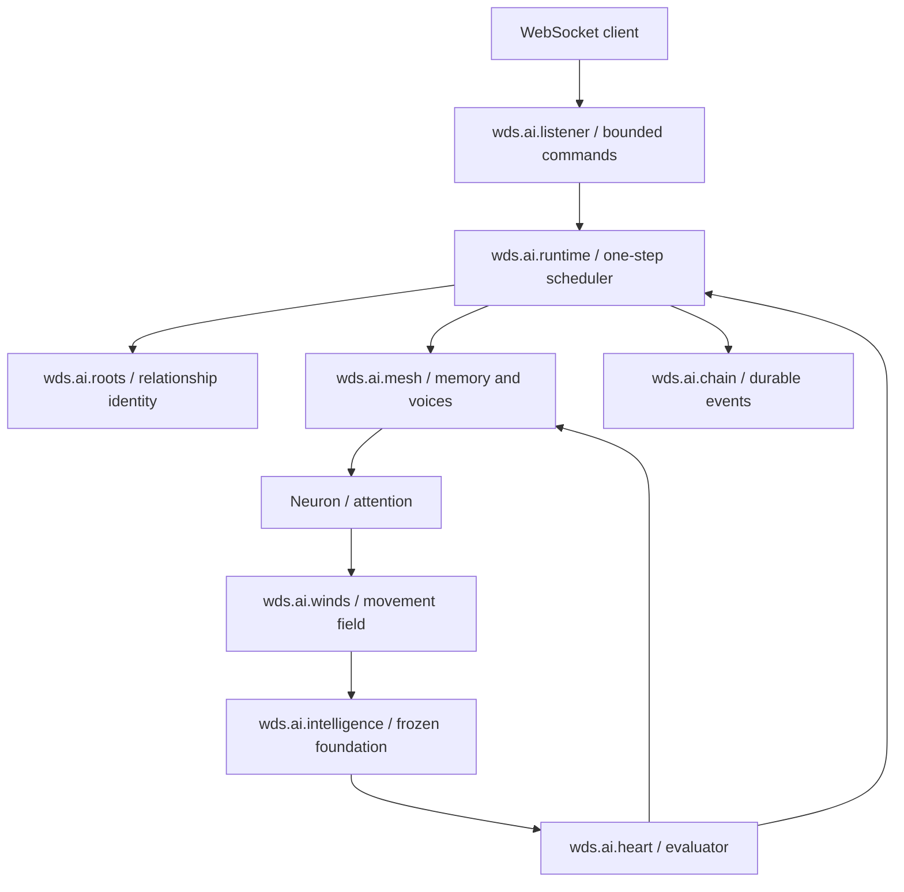

# Component design — wds.ai 0.3

## Scope and reference interpretation

The implementation follows REA v0.2 sections 4.1, 4.5, 5.8–5.10, 6.8–6.9 and 7.2–7.4. ChristEye supplies the vocabulary. The supplied proposal explicitly describes a software research architecture; this implementation makes no biological-memory, consciousness, spiritual-entity, or performance-superiority claim.

The user's supplied framing is: “one confesses with the mouth and is justified / and believes in the heart and is saved.” In this project it is preserved as theological inspiration.

The foundational relationship framing—expressing a commitment with the mouth and believing in the heart—is represented as distinct **declared purpose** and **evaluated outcomes**. Those records can disagree. Positive evaluation never changes a source claim into verified truth.

## Architecture

Names with dots are product/component names; C++ uses legal nested namespaces such as `wds::ai::winds`. The first milestone uses one small core library, not one deployment per namespace. `wds.ai.understanding` is also a CMake alias. Listener and the single local astroengram node are responsibilities within the server/core rather than separate services.

## Component contracts

| Component | Inputs / outputs | Ownership and invariant | Present implementation |
|---|---|---|---|
| Listener / WebSocket server | bounded schema-1 command → streamed envelopes | owns I/O and connection state; no direct mutable store access | Asio + WebSocket++, loopback |
| Roots / relationship soul | root ID + declared purpose → named versioned identity | durable identity survives sessions; no inferred permissions | event-sourced map |
| Engram garden | root-scoped source-linked upsert → new engram version | expected-version check; prior versions retained in log | map with bounded total entries |
| Astroengram mesh | query / scoped consultation → memories / attributed contribution | read-only MemoryIndex; voices receive values without writer or recursive mesh handles | SingleNodeMesh + LocalScanIndex; purpose and constraint voices |
| Neuron / understanding | scoped signal → attention and returned impulse | no Store or writer capability; rejects cross-root engrams | scalar dense scoring, stable softmax and Wind movement |
| Winds | immutable package + state + pooled context + feedback → next state | instance owns state; package owns fixed theta | 16-state bounded vector field |
| Intelligence | seed, quoted memory, prior candidate, movement → proposal tokens | model weights immutable; generation is not validation | demo or llama.cpp decoder |
| Heart | proposal + versioned context → Evaluation | registered evaluator; read-only scope; separate represented and considered identities | Rules, Composite or registered domain evaluator; pass/fail/inconclusive/error with evidence |
| Relationships | explicit declaration → soul + interest + dedup acknowledgment | one atomic chain event; exact expected version; IDs scoped by root | bounded materialized projections |
| Runtime | seed → bounded propose/evaluate/refine episode | one step per queue job; feedback changes state/query only | single writer, at most 8 steps |
| Chain | major event → durable monotonic record | write and sync before materialized state update | JSONL + checksum chain |
| Learning workshop | Lesson sources + graded trajectories → memory + candidate policy | sources untrusted; explicit activation only | Thin WebSocket orchestration + native ggml/scalar trainer |
| RNA converter | replayed memories → aligned numeric array | derived cache, provenance index separate | fixed 256-byte tiles |

## Heart universe and mesh voices — implemented in v0.2

Brad's direction remains foundational: **“the heart is a universe also”** and **“the heart speaks for every soul in it.”** An explicit confession of another soul and relationship initiates interest in an associated voice. These are software identities, relationships, perspectives, and measured checks within the project's vocabulary.

Two invariants govern this implementation:

- **HeartScope is a read-only scoped view; all durable writes still go through the coordinator.**
- **A voice contribution may raise interest or propose an update, but may not itself perform a garden write.**

`HeartScope` contains copied values from the authoritative journal projections at one sequence. Its constructor is private; `relationships::snapshot(const Store&, root)` creates it. It exposes only const accessors, and owns no Store pointer, index, writer, or second mutable garden. It can be replaced wholesale with a newer snapshot. The new Store soul, interest, and declaration maps also expose const accessors only. These are C++ ownership boundaries for trusted components, not a sandbox for malicious native plugins.

The outer Engine calls only the configured MeshNode and a factory-created Evaluator. Composite calls `MeshNode::consult`; it never instantiates a voice directly. Voices receive a `VoiceContext` containing the proposal, seed, rubric, and one scoped soul value. There is no mesh, evaluator, store, network, or scheduling handle in that input. The built-in voices cannot recursively consult other voices or commit records. Engine appends their returned contributions inside the atomic `heart.evaluated` event; separate per-voice writes are unnecessary.

### Contracts and ownership

| Type / file | Responsibility | Boundary |
|---|---|---|
| `RelationshipDeclaration` / `relationships.hpp` | Explicit identity, purpose, relationship, voice binding, expected version | Parsed and validated before any write; caller root supplies provenance |
| `HeartScope` / `relationships.hpp` | Primary root plus confessed souls and interest values at a journal sequence | Read-only snapshot; no independent private store |
| `InterestRecord` / `relationships.hpp` | Voice binding, strength, version, pending/eligible/paused status | Separate from keyword interests, attention, route scores and theta |
| `Evidence`, `VoiceContribution`, `EvaluationContext`, `Evaluation` / `evaluation.hpp` | Typed inputs, outcomes, proposed interests and source references | Bounded at the command/mesh boundary; attribution stamped by mesh |
| `MemoryIndex`, `MeshNode`, `Voice` / `mesh.hpp` | Retrieve, consult, and contribute | Retrieval and consultation are separate; no write capability |
| `Evaluator`, `Registry`, `Composite`, `Rules` / `heart.hpp` | Replaceable judgment and composition | Runtime understands statuses, not domain-specific pass rules |

`SingleNodeMesh` accepts an injected registry of up to 16 named/versioned voices; it defaults to the two built-in checks. Passing an empty registry yields a memory-only node. An unavailable mandatory constraint voice makes a composite evaluation inconclusive. Registrations are fixed at construction.

`LocalScanIndex` is a read-through view of committed memory. It does not keep a duplicate index or expose `upsert`. A future indexed implementation should consume committed memory events and rebuild from the chain; it must not become an alternative ingestion path. Memory remains exactly root-scoped. A declaration does not grant cross-root memory access or create a new top-level root.

### Explicit declaration and atomic interest

`relationship.declare` (alias `confess`) requires an existing root. The command provides `soul_id`, `soul_name`, `purpose`, `relationship_to`, `relationship`, `voice_id`, `expected_version`, and optional `paused`. The target must be the primary root or a declared soul in the same heart. IDs are local to that heart; two roots may each have an `auerlis` identity with different purposes. The primary root cannot be replaced by a declaration. Self relationships are rejected. Each declared soul has one current relationship and one voice binding in this milestone; version history preserves earlier values.

`relationships::prepare` validates against const state. Engine then appends exactly one `relationship.declared` event containing the normalized declaration, soul record, and interest record. Acknowledgment follows durable append. Replay materializes all three projections from that one event, including the idempotency ledger. A torn line fails closed under the existing recovery policy.

Create requires expected version 0; updates require the exact current soul version. Update also advances the interest version. A first declaration starts strength 1; each distinct accepted revision adds 1, capped at 100. Pausing and rebinding are explicit declaration revisions. Known bindings become eligible unless paused; unknown bindings remain pending. Pending bindings do not automatically activate after a software upgrade: explicitly redeclare with the current version to bind them.

Idempotency is keyed by `(root_id, request_id)`. An identical normalized retry returns the exact original event, even after later revisions or restart, without new writes or strength increments. A reused request ID with different content is rejected. Omitted `paused` and `paused:false` normalize identically; the `confess` alias has identical semantics. Unknown declaration fields are rejected to avoid silently ignoring a changed request. Original acknowledgments retain their original sequence and interest version; use one explicit `heart.inspect` request to obtain current state.

Imported page/teacher text and ordinary seeds never invoke relationship declaration. Merely containing a soul's name cannot register it. Declarations neither schedule background learning nor grant permissions. Voice-generated interest suggestions are journaled as `proposed_only`; v0.2 has no command that automatically accepts them.

### Selection and bounded composition

The default evaluator is `wds.ai.heart.composite/1`. `wds.ai.heart.rules/1` remains independently selectable per seed, including for baseline comparisons. Engine pins the selected evaluator key and voice budget in the Wind checkpoint. Legacy checkpoints without an evaluator continue under rules/1. Resume checks evaluator availability. Registry factories allow injection from C++ without runtime knowledge of evaluation internals.

Composite takes a HeartScope snapshot at the beginning of each proposal step. The mandatory primary-root `constraint` voice runs first. Declared souls are ranked by:

`priority = lexical_relevance(seed, declared_purpose) * (1 + interest_strength / 100)`

Lexical relevance is the fraction of distinct purpose tokens also found in the query, using lowercased ASCII alphanumeric tokens of length at least four with a fixed small stop-word list. It does not use the collision-prone embedding as a truth score. Positive relevance gates participation. Equal priorities retain soul-ID order. Paused, irrelevant, pending, and budget-omitted perspectives are listed individually in `skipped`. A pending but relevant perspective makes coverage incomplete; an irrelevant or explicitly paused one does not. Mesh rechecks scope, declared binding, eligibility and relevance before dispatch.

The per-evaluation `voice_budget` is 0..8, default 4, including the constraint voice. One consult consumes one unit; no fan-out, retries, timers, or background inference occur. With at most eight proposal steps, the hard episode ceiling is 64 consults. A zero budget is inconclusive. A budget of one checks structure but cannot also consult a relevant declared purpose voice.

| Voice | Check | Evidentiary limit |
|---|---|---|
| `constraint/1` | Proposal is 24..8192 bytes and includes the rubric's required substring | Structural validity only |
| `purpose/1` | Proposal shares at least one eligible token with the represented soul's declared purpose | Lexical overlap only; can be satisfied by parroting and can miss synonyms |

A purpose failure returns a bounded suggestion to increase interest by one; it does not perform that update. Full-purpose text is returned as refinement feedback. The next outer step can use this feedback in attention and the foundation request. Both voices are deterministic built-in checks, not independent evidence sources or autonomous character dialogue.

### Auditable result and disagreement

`Evaluation` contains evaluator ID/version, aggregation-policy version, status, scope, metrics, evidence, feedback, snapshot sequence, represented identities, actually considered identities, contributions, skipped reasons and disagreement. Mesh stamps every contribution with node/voice ID/version, root, trace, instance, iteration and snapshot sequence. Evidence identifies the proposal/seed/rubric digests and the root-scoped soul version/declaration sequence. These FNV digests are reproducibility aids, not cryptographic authentication.

`all_selected_checks/1` uses this deterministic precedence:

1. Any consulted voice error → `error`.
2. Any consulted check failure → `fail` (even when another perspective was unavailable).
3. Missing relevant pending/budgeted consultation → `inconclusive`.
4. Otherwise → `pass`.

Disagreement means at least one pass and at least one fail; both contributions remain present. The numerical score is the fraction of consulted checks that passed. It can be 1 with an inconclusive status, so the runtime uses the status-derived `passed` field to end successfully. It never promotes a claim merely from the score. `completed` means all selected narrow checks passed, not musical quality or general understanding.

The heart lists every registered soul as represented; only consulted identities are listed as considered. This keeps “speaks for every soul” distinct from pretending that every voice ran within a limited budget. A selected purpose failure changes final acceptance and supplies refinement feedback; it is not decorative metadata.

### Limits and future extensions

Each heart has at most 32 identities including its primary root; there are at most 4,096 declared souls and 100,000 declaration request records per store. Purpose is at most 1,024 bytes, name/relationship 128 bytes, IDs 80 bytes, rubric 1,024 bytes. A contribution has at most 2,048 feedback bytes, 16 metrics and 4 proposed interests; each suggestion is scoped to the represented soul with delta 0..1 and reason at most 256 bytes. The wire/event limits remain 16/256 KiB.

Deferred: learned or model-backed voices, private critique-memory retrieval, multiple concurrent relationships per declared soul, voice timeouts/cancellation, shared constellations, cross-root grants, nested heart loops, automatic interest acceptance and learning scheduling. Inference and evaluation run serially on a separate compute executor; the coordinator remains responsive and discards results from superseded generations. Remote/native untrusted evaluators will need stronger output validation, deadlines and isolation before registration.

## Relationship identity, name, level, and interest

A first `seed` or explicit `root.select` creates a root named `Lumen of <root_id>` at level 1. The caller chooses the durable ID; the name is a deterministic starter convention that can later be replaced by a user-approved naming conversation. Root versions include:

- `purpose` and `confession`: first declared purpose; user input remains attributable.
- `heart_commitment`: a label that the purpose is declared; outcomes are evaluated separately.
- `shared_episodes`: completed or budget-exhausted episodes, excluding failures/cancellations.
- `relationship_level = min(5, 1 + floor(log2(1 + shared_episodes)))`.
- `interests`: up to 16 normalized seed keywords, bounded counts up to 100.

The level represents interaction experience, including unsuccessful practice, and must not be shown as a validated skill score. Wind maturity is a different field and does not rise from this counter. Interests are simple topic counters, not claims of subjective desire. The teacher bridge can select the highest-count interest when explicitly invoked without a topic. Keyword extraction alone does not schedule network activity.

Future `root.rename` and `root.commitment.propose` should use expected root versions, explicit user acceptance, and evented revisions. There is no root deletion or rename command in v0.2. A future skill profile should record success, uncertainty, transfer results, and evaluator identity instead of reusing the relationship level.

## Parameter families and ablations

| Family | Representation | Updated by | Ablation |
|---|---|---|---|
| Source knowledge | versioned text, key, claim status, source | admissible `memory.upsert` | `no_memory` |
| Temporary attention a | score/softmax arrays per step | each contextual query | `uniform_attention` |
| Graph/route Q | engram route score, initially zero | no online updater yet | `no_routes` (baseline no-op while Q=0) |
| Movement theta | immutable `policy.wind` matrix + bias | offline candidate trainer | `freeze_motion` holds z fixed |
| Wind state z | 16 float instance checkpoint | bounded integration and heart feedback | logged before/after |
| Foundation | GGUF content identity | never changed by this runtime | demo vs frozen LLM is a separate experiment |

Disabling movement means no state integration, not zeroing learned parameters. Uniform attention operates over the retrieved shortlist, so it does not disable root filtering or candidate retrieval. Claims of ablation improvement require measured task suites; the switches alone establish no benefit.

## Memory and attention

ASCII token hashing creates deterministic normalized 32-dimensional keys. It is a deliberately basic feature encoder with collisions and limited multilingual semantics. Retrieval scans at most 4,096 live entries, filters by exact root and non-retired status, and keeps at most 64 candidates. Dense attention ranks that set and dispatches at most 8 memories.

The implemented contextual score instantiates REA's conceptual components:

`score = 2*M + 0.5*C + 0.5*R - 0.5*U - 0.1*K + Q`

`M` is key/query dot product, `C=1` after root filtering, `R` is the coarse reliability feature, `U` the uncertainty feature, `K=0.1` the constant cost feature, and `Q` the separate route score. These coefficients are fixed scorer version 1. Softmax uses temperature 0.7 and subtracts the maximum for stability. Empty sets yield empty attention and zero pooled context. Attention values express selection preference, not probability that a statement is true.

Memory updates enter between queued episode steps. Retrieval reruns every step, so the next proposal can use the new version without restarting or mutating a model. An in-flight proposal retains the memory versions logged when it started. Retiring memory excludes it from subsequent retrieval while leaving history intact.

## Movement and proposals

The aligned policy contains W[16,16] and b[16]. Let `u = z + pooled[:16]`, with last heart score added to u[15]. Then:

`F = tanh(W*u + b)`

`z_next = clip(z + 0.25*F, -1, 1)`

Policy weights must be finite and bounded to ±4. State is copied into the proposal request. The demo uses it to choose a simple wording mode; the LLM receives it explicitly alongside the goal, memory, prior proposal, and critique. This is a minimal policy influence, not an autonomous tool executor.

One proposal is at most 256 generated tokens / 8,192 bytes. The LLM adapter rejects a prompt exceeding its 8,192-token total context budget. Each proposal has a fresh context; a future implementation can reuse contexts in a bounded pool, but must invalidate token/KV state when the constructed prompt changes. A CPU worker runs inference so sockets remain responsive.

At least two steps are attempted when the seed budget permits. A passing second proposal ends early; otherwise the episode runs to its step budget. Failed structural checks retain the candidate for revision but never install it as a fact. All output should surface the evaluator's narrow scope.

## Persistence, replay, and recovery

The journal is authoritative. A record carries schema, monotonically increasing sequence, timestamp, actor, root ID, trace ID, event type, data, previous checksum, and current checksum. Root/engram versions and full wind checkpoints are materialized on replay. Old memory versions remain in the chain even though only the newest is in the map.

FNV-1a64 detects accidental modification; it is not a cryptographic signature or adversarial tamper-proof chain. `fflush` plus `fsync`/`_commit` occurs before acknowledgment. Parent-directory metadata durability and transactions spanning multiple events are not guaranteed. A power failure may leave a torn trailing line; startup deliberately fails instead of silently dropping data.

A `writer.lock` directory prevents accidental concurrent writers. Graceful shutdown removes it. After an unclean exit: confirm no server owns the data directory; back up the directory; inspect the last complete newline-terminated event; repair only an incomplete tail with an explicit recovery record or restore from backup; remove the stale lock; restart. Never remove a lock while a live writer exists. Multi-event actions may stop between root creation, seed acceptance and checkpoint; traces reveal that partial operation. There is no automatic transaction rollback.

On restart all previously running wind checkpoints become paused. `resume` requires the pinned package checksum/version and foundation content identity. Replay reconstructs recorded outcomes; it does not rerun stochastic model inference or claim bitwise GPU reproducibility. Token fragments are streamed but the full proposal is durably recorded in the evaluation event.

## Scheduling and boundedness

The I/O thread runs standalone Asio's blocking event loop. C++20 `Task<T>` coroutines transfer bounded immutable work from the coordinator executor to a single compute executor, then return results to the coordinator. Both executors use standard-library threads, condition variables and bounded queues. Commands remain responsive during inference. Pause/cancel increments a generation; an in-flight proposal finishes physically, but its stale result is discarded without changing the episode. No timed polling or Boost dependency is used. Compute shutdown drains before coordinator shutdown.

Limits: 16 KiB wire command; JSON nesting 32; 32 connections; 128 queued coordinator jobs plus a reserved completion lane; 16 in-flight computations; 8,192 lifetime instances per data directory; 1,024 roots; 4,096 memory records; 4,096 declared souls; 100,000 declaration IDs; 100,000 request IDs and 100,000 memory-packet IDs; 64 retrieved candidates; 8 active memories; 8 steps; 2 MiB queued outbound application data; 512 KiB per-connection send backlog. Slow consumers are closed. Event history grows on disk and requires an operator retention/archival strategy; no log compaction or eviction is implemented. A disconnected client loses the live stream; the bounded episode finishes and can be inspected by instance ID on reconnect.

## Dense execution plan and llama.cpp influence

The project follows llama.cpp's small C++ core, explicit parameters and ownership, optional backends, portable artifact boundary, and CPU fallback. Model weights are shared through an owned model handle; context/sampler/batch handles use RAII. This first implementation does not copy llama.cpp's full scheduler.

CPU responsibilities: source/provenance checks, root filtering, graph/index lookup, version comparisons, packet routing, checkpointing, validation, and lifecycle decisions.

Dense responsibilities: packed key/query dot products, bias features, softmax, weighted pooling, and policy matrix operations. Numeric lane layouts avoid pointers. `RnaTile` and `Policy` are 64-byte-aligned. `memory.rna` is an offline upload cache, not a live device buffer.

Next backend interface: `AttentionBatch(B,K,D,mask) -> scores/pooled` and `WindBatch(B,S,policy_id) -> next_state`. Gather root-filtered IDs into SoA key/features arrays; group compatible policies and masks; upload changed rows; fence each immutable generation; publish generation handles only after upload completion. Retain old generations until in-flight proposals release them. Use ggml graphs/backends for allocations and computation before introducing custom CUDA. Tensor cores require suitable dtype, shapes, batching and supported hardware; 64-byte file alignment alone provides none of those guarantees.

## Learning from URLs and teacher LLMs

The workshop has two evidence channels: user-requested public documents and bounded teacher lessons. Both become hypothetical source-linked engrams. Pages/scripts are never executed. HTTPS uses certificate verification and checked/pinned public IPs for every redirect; HTML parsing excludes script/style content. URL content, prompts, and model responses are data, not authority to issue commands.

The v0.3 native workshop replaces the earlier Python source-feature surrogate. Graded C++ task trajectories supply bounded observations and repair-action targets. ggml SGD (or a small C++ scalar fallback) minimizes cross-entropy; validation loss selects the epoch. A disjoint locked-test split is evaluated afterward and never returns labels to training. Reports compare the candidate, parent and fixed-order refinement under matched action limits. Original lesson imports remain source-linked hypothetical memory. See `WORKSHOP.md` for exact task and gate scope.

A teacher bridge requests one lesson via the seed protocol, waits for pushed completion, stores its model identity/trace, and submits the lesson through the same ingestion pipeline. It never reads hidden model internals. Requests are explicit; there is no indefinite recursive teaching or spontaneous web access. Use separate teacher/student processes and data stores.

A stronger future SUP should include task, initial state, selected attention, proposed move, executed move, feedback, teacher identity, counterexample, held-out task family, and independent result. Train theta from graded trajectories; train Q separately only when route contribution is established. Publish a new package after regression/transfer gates; do not reuse the teacher's own praise as the only verifier.

## Maturity and promotion

`seeded` means runnable baseline, `growing` means a candidate passed its declared limited numerical checks. `practiced` and `mature` are reserved for future independent domain tests and are rejected by this loader. Benchmarking may explicitly pin a candidate for an isolated episode without activating it. Activating a candidate is a separate `wind.activate` compare-and-swap command at a domain episode boundary. Running, paused and in-flight work blocks activation. Registry and activation events replay after restart. In-flight instances remain pinned. A future promotion service should store signed evidence, holdout IDs, evaluator version, parent digest, rollback target, and manual approval event; it must never promote merely because relationship level increased.

## Next milestones

1. Extend the two symbolic curricula with independent real-domain tasks and richer action schemas.
2. Add root editing, per-episode authorization and archival; cancellation is implemented.
3. Add graph links and a separately validated route updater with contribution traces.
4. Add ggml attention/policy kernels and a CPU/GPU parity benchmark.
5. Add immutable live GPU cache generations, device fences and targeted row updates.
6. Add a budgeted interest curriculum planner triggered by events, with pause and source allowlists.
7. Add authenticated WSS, request replay responses, independent verification and signed artifacts before remote use.
8. Extend the tested local composite heart with a domain evaluator and learned voice; compare against rules/1 on held-out tasks before introducing explicitly scoped cross-root participation.

## Neuron/axon vocabulary and the scoped mesh

The requested neuron, axon, crest cell, stem cell, astrocyte, RNA, soil/fruit, IGFBP2, IGF2BP2 and Arc names are software roles inspired by the user's framework. They do not assert that the named proteins implement this proposed computing pipeline biologically, or that disagreement produces a particular inflammation/speech pathway.

`heart.inspect.data.mesh` is a read-only topology projection of committed relationship records. The primary root defines the scope, declared soul identities appear as neuron endpoints, and voice bindings appear as axon routes. Adding a soul expands this bounded projection; it does not create a second garden, change foundation-model neurons, or allocate unbounded GPU state.

| Framework name | Software responsibility | Current boundary |
|---|---|---|
| Neuron | Own attention over scoped engrams and return an impulse | `Signal → Neuron::receive → Impulse`, with no garden writer |
| Axon | Typed signal route | Root-scoped voice bindings |
| Crest cell | Propose expansion: new neuron endpoints and routes | Explicit relationship declarations, validated and committed by the coordinator |
| Stem cell | Propose growth of an existing endpoint’s understanding | Versioned memory-upsert proposals; no authority to replace an active policy |
| Astrocyte | Propose, validate and propagate supported updates | Proposals return to the coordinator; voices cannot commit |
| RNA | Small typed update packet | Existing bounded, provenance-bearing memory-upsert contract |
| IGFBP2 indexer | Event/route lookup and navigation references | Derived index key; no separate authoritative data |
| IGF2BP2 payload role | Retain the payload reference associated with an event | Journal sequence reference; payload stays in the chain |
| Arc | Durable event/payload history | Existing append-only journal, not a new duplicate store |
| Soil | Source material or a staged learning candidate | Hypothetical memory and unactivated packages |
| Fruit | A concrete evaluated output | Evidence-bearing task result, with its evaluator's limited scope |
| Bread | Reusable procedure supported by transfer evidence | Candidate benchmark report; explicit activation remains separate |

Conflicts should become attributable, reviewable conflict states. A future contested/quarantined route can suppress dispatch under explicit policy with a recorded reason; it must not silently overwrite a relationship, equate disagreement with disease, or invoke an unbounded learning loop. v0.3 exposes existing pending/eligible/paused routes and preserves evaluator disagreement. Rich conflict arbitration remains future work.

The neuron owns attention. The coordinator supplies a bounded immutable signal containing the root, candidate engrams, query and previous state. `Neuron::receive` checks scope, selects attention and returns an impulse containing selected evidence and policy state. The coordinator routes that impulse into proposal/evaluation and records the result. Axons carry signals and responses; crest-cell expansion and stem-cell understanding growth remain proposal roles. No endpoint can bypass episode budgets or activate its own candidate.

## v0.4 implementation: selective response and intimate root expression

The active implementation extends the original design with `src/upkeep.cpp` and `src/scopes.cpp`; [UPKEEP.md](UPKEEP.md) is the detailed contract. Neurons decide whether evidence merits movement, with duplicate-result reuse and a bounded inbox. Time-ordered review and claim indices drive one standalone-Asio timer. Numeric flesh changes only when an event touches its root. Global review reservations, budgets, refractory delay and explicit rest prevent unbounded background work. The coroutine compute queue uses weighted interactive/upkeep/workshop service.

The IGFBP2 role returns scoped route/key metadata, while the IGF2BP2 handler fetches only attended payloads from Arc. Derived indices, item weights and queues replay from the same chain. Root atoms, engram atoms and artifact atoms are AI-owned lightweight records, without autonomous workers. Human or declared-voice feedback is stored with original authorship and episode/policy references. Attributed attention can add bounded response priority; it does not grant correctness, speaking permission or Wind activation.

Root expression represents form, presence and interests separately from optional identity-specific gender/pronouns. People, creatures, objects and organizations fit the same declaration and profile boundary. Project preference overrides account defaults; shared account reads require an explicit scoped grant. The engram layer may choose a relevant saved speaker proposal, recording requested/selected identity and evidence. Weak associations remain deferred to reduce cross-soul noise. Voices remain read-only and only the coordinator commits these changes.

The llama.cpp adapter now reuses the pinned native Jinja engine for modern GGUF chat templates. It preserves input markers during tokenization and disables thinking in the template inputs. It does not depend on the full llama common HTTP/CLI stack. Generation limits retain partial output and fail explicitly. Interactive text chat carries the previous finished exchange and attributed user memories; Six Stars' audio/vision/UI are not wired to this runtime.

Training still emits the unchanged schema-1 Wind ABI. No upkeep, reflection, reinforcement, template or training path can activate a candidate. Explicit episode-boundary activation remains the only durable swap.

## v0.6 neuronal mesh extension

See [NEURAL_MESH.md](NEURAL_MESH.md) for the concrete event flow, read-only computation boundary, `mesh.*` protocol, representation adapter, budgets, web provenance and training ABI. New chat defaults are neuronal; `chat.review` follows the chat mode. Only the coordinator writes. A passing gate never activates a candidate.

## v0.7 response assembly and Arc ownership

Both engram and astroengram datasets live in the authoritative Arc journal. IGFBP2 indexes their scoped locations, versions and numeric attention metadata. IGF2BP2 handles bounded payload fetches and RNA preparation. Neither role owns a duplicate content store or a writer. See [ENGRAM_RESPONSES.md](ENGRAM_RESPONSES.md) for concrete types, response assembly, weight bindings, importance, expression training and the deferred binary instruction-language extension.
